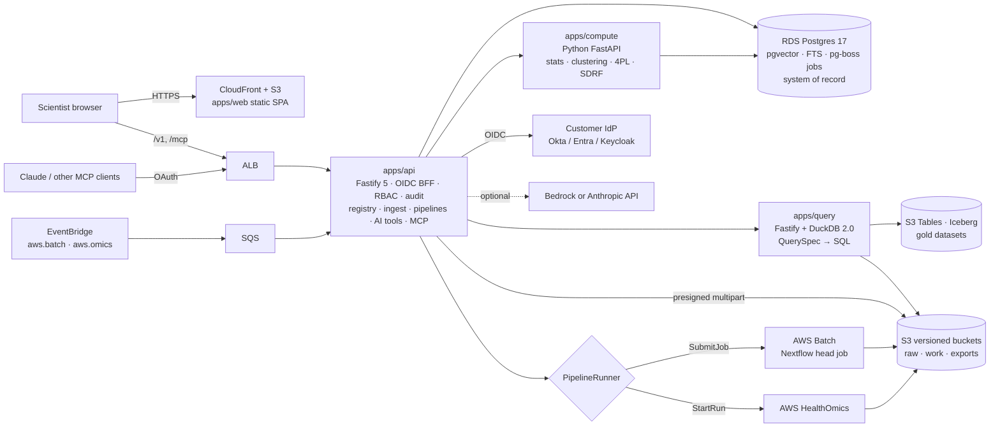
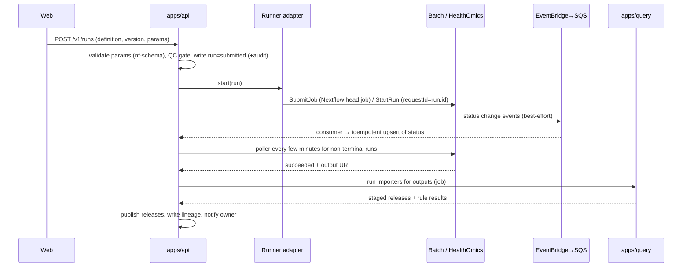

# Tributary — Architecture

Status: v2.0 baseline · Versions checked against npm/PyPI on 2026-10-25 (Phase 0 re-verifies and pins).
Decisions are summarised in §14; new decisions go in `docs/adr/` (template in `docs/adr/README.md`).

---

## 1. System overview



One deployment per customer AWS account (single-tenant). Four deployables plus static web assets.

---

## 2. Monorepo layout (pnpm + Turborepo; Python managed by uv, orchestrated by Turborepo tasks)

| Path | Contents |
|---|---|
| `apps/web` | Vite 8 + React 19 SPA. Routes: experiments, experiment/:id, explorer, datasets, runs, compounds/:id, proteins/:id, search, admin, settings. |
| `apps/api` | Fastify 5. Modules: auth, programs, registry, samples, files, ingest, datasets, pipelines, runs, views, search, lineage, audit, admin, ai, mcp. Jobs via pg-boss. |
| `apps/query` | Fastify + `@duckdb/node-api`. QuerySpec compiler, importer executor, exports. Internal only. |
| `apps/compute` | Python ≥3.12, FastAPI, uv. Endpoints: cluster, kde, pvalues, fit-4pl, pca, sdrf-validate; pg-boss worker for long jobs; `synth` CLI for demo data. Internal only. |
| `packages/contracts` | zod 4 schemas: entities, manifest, QuerySpec, ChartSpec + chart registry, dataset contracts, tool registry types. Emits OpenAPI 3.1 + JSON Schema (for Python pydantic generation). |
| `packages/db` | Kysely 0.29 types (kysely-codegen), SQL migrations, seed. |
| `packages/importers` | Importer modules: detect → map → DuckDB SQL → quality rules. Golden-file tests with synthetic fixtures. |
| `packages/ui` | Shared React components (grid wrappers, ontology picker, quantity input, plate view). |
| `pipelines/` | `demo/` tiny Nextflow pipeline (writes fixture outputs) for local e2e; param templates for supported pipelines. |
| `fixtures/` | Small synthetic files generated by `pnpm synth` (committed, deterministic seed). |
| `infra/terraform` | Modules: network, ecs-service, rds, s3, s3tables, batch, healthomics, eventbridge-sqs, cloudfront, kms, iam. `envs/dev` (written by Claude); `envs/prod` created and edited by a human only (a hook blocks Claude). |
| `e2e/` | Playwright specs + screenshot baselines. |

---

## 3. Technology stack (numbers are 2026-10-25 registry values; **Pinned** = installed in Phase 0, 2026-10-26)

| Layer | Choice | Version seen | Notes |
|---|---|---|---|
| Runtime | Node.js 24 LTS | — | `.nvmrc`; pg-boss and Vitest 5 need ≥ 22.12. **Pinned:** 24 (24.22.1 tested). API and query run `.ts` with Node's built-in type stripping (no tsx). |
| Package manager | pnpm | 12.15.0 | `packageManager` field; `save-exact=true`. **Pinned:** 12.15.0. pnpm 12 enforces a minimum release age: pin versions old enough rather than adding `minimumReleaseAgeExclude`. |
| Monorepo | Turborepo | 2.11.10 | **Pinned:** 2.11.10. |
| Language | TypeScript (strict) | 6.0.3 | Not 7.x yet: TS 7.0.2 (native) ships no tsserver (needed by the LSP plugin) and typescript-eslint 8.72 supports `<6.1`. Revisit when both support 7. **Pinned:** 6.0.3; typescript-eslint 8.72.0, ESLint 10.13.0, Prettier 3.9.10. |
| Web | React 19 + Vite 8 | 19.3.1 / 8.3.5 | SPA, no SSR. **Pinned:** 19.3.1 / 8.3.5, @vitejs/plugin-react 6.1.2. |
| Routing / data | TanStack Router / Query | 1.170.x / 5.104.x | **Pinned:** 1.170.46 (code-based routes, no router plugin) / 5.104.5. |
| Grid | AG Grid Community (MIT) | 36.2.0 | Enterprise features not used. |
| Charts | Plotly.js 4 + react-plotly.js | 4.1.2 / 4.1.0 | Custom partial bundle, lazy-loaded. |
| Query builder | react-querybuilder | 8.25.0 | JSON rules → server compiler. |
| CSV/TSV | Papa Parse | 5.7.0 | Web Worker mode. |
| UI kit | Celeste's kit if any; else Tailwind + shadcn/ui | verify | Decide in Phase 0. |
| API | Fastify 5 + fastify-type-provider-zod | 5.12.7 / 7.0.0 | **Pinned:** fastify 5.12.7 (type provider added in Phase 1+). |
| Schemas | zod 4 + @asteasolutions/zod-to-openapi | 4.6.7 / 9.1.0 | OpenAPI 3.1. **Pinned:** zod 4.6.7. Phase 1 emits OpenAPI components and JSON Schemas with zod 4's built-in `z.toJSONSchema` (ADR-0015); zod-to-openapi is not used. Python models: datamodel-code-generator 0.83.0 (MIT, dev-only). |
| DB access | Kysely + kysely-codegen | 0.29.7 / 0.20.0 | SQL migrations via Kysely Migrator. |
| Database | PostgreSQL 17 + pgvector | pgvector 0.8.7 | RDS in prod; `pgvector/pgvector` image locally. |
| Jobs | pg-boss | 12.38.0 | Cron, retries, dead-letter. No Redis. |
| Query engine | DuckDB via `@duckdb/node-api` | 2.0.x LTS | Same DuckDB version in Python. Consider waiting for 2.0.1. **Pinned:** `@duckdb/node-api` 2.0.0-r.1 (Python duckdb to match when added). |
| Table format | Apache Iceberg in Amazon S3 Tables | Iceberg 1.12 | Local: SeaweedFS Iceberg REST catalog. |
| Auth | openid-client + jose; CASL | 6.8.8 / 6.2.13; 7.0.2 | BFF sessions. |
| Python compute | FastAPI, pydantic, scipy, statsmodels, scikit-learn, numpy, pandas/polars, pyarrow, duckdb, sdrf-pipelines (pydeseq2 optional) | 0.162 / 2.14 / 1.18 / 0.15 / 1.9 / 2.5 / 3.1 / 2.0 / 26 / 2.0 / 0.1.6 (0.5.4) | All permissive. No inmoose: it is GPL-3.0-or-later (PyPI, checked 2026-10-26). |
| Testing | Vitest 5, Testcontainers 12, Playwright 1.64, pytest | 5.0.5 / 12.2.1 / 1.64.1 | **Pinned:** vitest 5.0.5, @playwright/test 1.64.1, @playwright/mcp 0.0.83, pytest 9.1.1, httpx 0.28.1 (ASGI transport for tests), ruff 0.17.2, pyright 1.1.414, fastapi 0.162.0, uvicorn 0.54.0, pip-licenses 5.5.5. Integration tests use real Postgres/SeaweedFS containers, not mocks. |
| AWS SDK | @aws-sdk/client-* v3 | 3.1156.x | omics, batch, s3, sqs, cloudwatch-logs, s3tables. |
| AI (optional) | Vercel AI SDK (in-app assistant), MCP TypeScript SDK v2 (`@modelcontextprotocol/server`), Anthropic/Bedrock providers | verify | Claude Agent SDK only for sandboxed batch analysis (later). |
| Observability | pino, `@fastify/otel`, OpenTelemetry SDK | 0.21.4 / 0.300.0 | `@opentelemetry/instrumentation-fastify` is deprecated. |
| IaC | Terraform (OpenTofu-compatible HCL) | 1.15–1.17 | CDKTF is archived — don't use. |
| Local stack | Docker Compose: Postgres+pgvector, SeaweedFS, Keycloak | `pgvector/pgvector:0.8.7-pg17-trixie`, `chrislusf/seaweedfs:4.51`, `keycloak/keycloak:26.8.1` (Docker Hub mirror of quay.io) | MinIO CE is unmaintained; LocalStack free tier is non-commercial. |

---

## 4. v1 → v2 mapping

| v1 | v2 | Why |
|---|---|---|
| FastAPI microservices (auth, admin, metadata-access, data-access) | One Fastify API + DuckDB query service + internal Python compute | Fewer deployables; Node-first like Celeste; Python only where the science libraries live. |
| Single-vendor SSO | Any OIDC IdP | Each customer brings its own IdP. |
| RabbitMQ | pg-boss on Postgres (+ SQS only for AWS events) | No broker to operate. |
| OpenSearch (manifests, semantic search) | Postgres JSONB + full-text + pgvector | Removes a ~$175–350/month floor; scale fits Postgres. |
| Neptune (file lineage) | Postgres lineage tables, OpenLineage-shaped | Shallow graphs; recursive CTEs suffice. |
| Redshift (gold layer) | Iceberg in S3 Tables + DuckDB; Athena optional for analyst SQL | Warehouse only justified at many concurrent BI users. |
| Glue crawler + catalog | S3 Tables' managed catalog/Glue integration | No crawlers. |
| Lambda crons | pg-boss cron / EventBridge Scheduler | Fewer moving parts. |
| lakeFS | Versions as data in Postgres + S3 Versioning + Iceberg snapshots for operational undo | lakeFS moved to BUSL-1.1 (internal-use grant) — unfit for a product shipped to customers. |
| EKS | ECS Fargate | No cluster to run for 4 services. |
| Plotly (server-built figures) | Plotly.js in the browser from server-shaped data; statistics in apps/compute | WebGL, faster interaction. |
| Ad-hoc validation | zod contracts + chart registry + ODCS dataset contracts | Kills v1's defect class (REFERENCE_V1 §8). |

---

## 5. Data architecture

**System of record (Postgres).** Programs, templates, experiments, versions, samples, contrasts, files,
datasets, releases, pipeline definitions and runs, saved views, lineage, audit, users/roles, OLS term cache,
pg-boss queues. Published rows protected by triggers (`BEFORE UPDATE OR DELETE … RAISE` when status is published).

**Object storage layout (versioned buckets, SSE-KMS).**
```
s3://<tenant>-raw/   programs/<program>/experiments/<exp>/v<n>/raw/<file>
s3://<tenant>-work/  runs/<run-id>/work/…   (lifecycle: expire after N days)
s3://<tenant>-work/  runs/<run-id>/output/…
s3://<tenant>-exports/ users/<user>/<export-id>.<csv|tsv|parquet> (expire after 7 days)
```

**Gold datasets (S3 Tables / Iceberg).** One table per dataset kind (e.g. `gold.differential_abundance`),
append-only, partitioned by `experiment_version_id` (or `bucket(N, experiment_urn)` if partitions get too
many). A DatasetRelease records the Iceberg `snapshot_id` and the release's `release_id` column value.
Business time travel = filter by release/version IDs, never by snapshot retention. Retention per table:
`minSnapshotsToKeep ≥ 50`, `maxSnapshotAgeHours ≥ 2160`. Do **not** create Iceberg tags/branches on
S3 Tables (they disable automatic snapshot management). Drafts land in a `staging` namespace and are
promoted with `INSERT … SELECT` on publish.
Fallback where S3 Tables isn't available in the customer's region: Iceberg on plain S3 with a self-run
REST catalog (Lakekeeper/Nessie/Polaris, all permissive) — or DuckLake (Postgres catalog) if AWS-native SQL
(Athena) isn't needed. Confirm S3 Tables availability in the customer's region in Phase 8.

**Local equivalents.** SeaweedFS provides S3 (port 8333) and an Iceberg REST catalog with table buckets;
DuckDB attaches to it the same way it attaches to S3 Tables.

---

## 6. Query service (apps/query)

- Separate ECS service (4 vCPU / 16 GB to start) so DuckDB memory spikes can't take down the API.
- DuckDB settings: `memory_limit ≈ 75%` of task RAM, `threads = vCPUs`, `temp_directory` on ephemeral
  storage, external file cache on, one DuckDB instance per process, a semaphore on concurrent heavy queries,
  per-query timeout (default 30 s) and row cap.
- Compiler: QuerySpec → AST validation against release contracts (column whitelist, type map, operator ×
  type matrix) → parameterized SQL. Joins only on declared keys unless the advanced flag is set by a role
  allowed to. Program scoping is injected before compilation from the caller's abilities.
- Transport: JSON pages (25–1,000 rows) for the grid; large chart payloads as compressed columnar JSON or
  `COPY … TO 's3://…/result.parquet'` + presigned URL (browser reads with hyparquet).
- Importers execute here (read raw outputs with `read_csv`/`read_parquet`, map, check rules, write releases).
- Benchmark locally in Phase 12 and in-region in Phase 22 (no published benchmark exists for DuckDB 2.0
  against S3 Tables at this scale).
- Metadata kinds (SPEC §6.2) are read live from program-scoped Postgres views through DuckDB's postgres
  extension, using a separate read-only database role.

## 7. Compute service (apps/compute)

| Computation | Where | Library |
|---|---|---|
| limma / DESeq2 / edgeR | Pipeline containers only (e.g. nf-core/differentialabundance running R) | limma and inmoose are GPL: never in-process. pydeseq2 (MIT) optional for DESeq2 re-runs, validated vs R |
| Multiple testing | TS for BH; Python for the full set | statsmodels `multipletests` |
| Hierarchical clustering + bootstrap support | Python | scipy.cluster.hierarchy + custom resampling (no pvclust in PyPI) |
| KDE | Browser for small n, else Python | scipy.stats.gaussian_kde |
| 4PL dose-response fits | Python | scipy.optimize.curve_fit with bounds |
| PCA | Python | scikit-learn |
| Pseudolog, z-score, bins, error bars | TypeScript | — |
| SDRF validation | Python | sdrf-pipelines (Apache-2.0) |
| Synthetic demo data | Python | numpy (seeded) |

Synchronous endpoints for jobs < ~10 s; longer jobs claimed from pg-boss with progress rows. Guards:
≥ 2 samples for clustering, no all-NaN rows, ≥ 2 distinct values for KDE, ≥ 4 dose levels for 4PL, finite
p in (0, 1]. Errors are structured (`code`, `field`, `message`) so the UI can show them next to the control.
A TypeScript client is generated from the FastAPI OpenAPI schema.

## 8. Pipelines and run status



- **Batch adapter:** a Nextflow head-job container running `nextflow run <repo> -r <rev> -params-file
  s3://… -work-dir s3://…` with the `awsbatch` executor. Batch emits no event for initial submission, so the
  API writes `submitted` itself. Works in every region; Spot-capable; tuned Batch measured 1.4–2× faster and
  0–44% cheaper than HealthOmics in an Aug 2026 comparison, but takes longer to set up.
- **HealthOmics adapter:** `StartRun` with idempotent request ID; run groups per program for caps; run cache
  for reruns. Only 8 regions (none in India); isolated network by default (bundle modules); VPC mode exists.
- **Logs:** HealthOmics log group `/aws/omics/WorkflowLog` (`run/<id>/engine`, `run/<id>/task/<taskId>`);
  Batch head-job stream from DescribeJobs. Show recent lines via FilterLogEvents; deep-link to the console.
- **Never** rely on Nextflow weblog (removed in 26.09-edge).

## 9. Licences — what we may copy, run or only read

**Safe to depend on or copy patterns from (permissive):** Nextflow (Apache-2.0), nf-core pipelines (MIT),
bigbio/quantms + quantmsdiann, QPX, sdrf-pipelines + sdrf-templates (Apache-2.0), Galaxy (MIT, from Feb 2026),
cBioPortal (Apache-2.0 only for releases from Oct 2026), SEEK (BSD-3), LabKey (Apache-2.0), Quilt (Apache-2.0),
CELLxGENE (MIT), Phantasus/Morpheus (MIT/BSD-3), SODAR (MIT), Dash Bio (MIT — port its volcano/clustergram
parameter designs), Plotly.js, react-querybuilder, AG Grid Community, TanStack, igv.js, Mol*, RDKit.js, Ketcher,
EBI OLS4 (Apache-2.0, self-hostable), LinkML, Iceberg, DuckDB, OpenLineage, ODCS, datacontract-cli.

**Run only as separate pipeline containers / processes, never copied into product code:**
limma (GPL), inmoose (GPL-3.0-or-later; Python port of limma/edgeR/DESeq2), DEqMS (LGPL), MultiQC (GPL-3),
FragPipe GPL/LGPL components, FragPipe-Analyst (GPL-3).

**Do not copy or depend on:** Arvados core (AGPL), cBioPortal releases before Oct 2026 (AGPL), UpSet.js
(AGPL/commercial), Metabase and eLabFTW (AGPL), SENAITE (GPL-2), Omics Playground (non-commercial licence
explicitly naming consulting), ISA-API (CPAL network clause), the SDRF specification repo files (GPL-2),
InCHlib (no licence), Soda Core v4 (Elastic 2.0), OpenMetadata ingestion (Collate licence), lakeFS ≥ 1.87
(BUSL-1.1; its README also objects to AI agents reading its code — keep it out of Claude Code entirely),
MinIO CE (AGPL, unmaintained).

**Proprietary tools — ingest outputs only, never bundle:** DIA-NN (academic edition is non-profit only),
Spectronaut, MaxQuant. Have counsel confirm the container-separation pattern before the first sale.

## 10. Auth and security architecture

- OIDC authorization code + PKCE in apps/api (`openid-client`); server-side session in Postgres;
  httpOnly SameSite=strict cookie; CSRF token for mutations; per-customer config: issuer, client ID/secret,
  groups claim, group → role mapping. Keycloak realm in Docker Compose for local dev and e2e.
- CASL abilities built per request from role bindings; same ability definitions exported to the web app for
  UI gating (never trusted for enforcement).
- Service accounts and personal access tokens (hashed, scoped, expiring) for API/SDK and MCP clients.
- Publish/approve requires recent authentication (`max_age`), recorded in the audit row.
- Secrets in AWS Secrets Manager (rotation for RDS); config in SSM Parameter Store.
- KMS customer-managed keys for S3, S3 Tables, RDS; TLS 1.2+; security headers via `@fastify/helmet`;
  rate limits via `@fastify/rate-limit`.

## 11. AI architecture

- `apps/api/src/ai`: provider abstraction (`anthropic`, `bedrock`, `none`), tool registry (zod in/out, risk
  class, permission, budgets), assistant endpoint (streaming, Vercel AI SDK tool loop with `needsApproval` for
  write/compute tools), conversation storage (minimal), provenance writer, eval harness.
- `apps/api/src/mcp`: MCP TypeScript SDK v2 server (Streamable HTTP via Fastify adapter) exposing the same
  registry; OAuth 2.1 with audience-validated tokens from the customer IdP (or platform-issued tokens), no
  token passthrough, per-client consent, least-privilege scopes, outputs summarised under ~25k tokens,
  write tools marked as requiring user interaction.
- Tools call internal services with the **end user's identity**; query tools accept QuerySpec only.
- Bedrock keeps inference inside the customer's AWS boundary; note that the Anthropic Life Sciences
  Verification Program (relaxed biology safeguards) is first-party only — design every feature to work on
  general-availability safeguards.
- Embeddings (optional): Titan Text Embeddings V2 on Bedrock (256–1024 dims) or Voyage 4; stored as
  `halfvec`/`vector` with HNSW; ontology normalisation + lexical search carry most of the relevance.

## 12. Deployment and environments

| Env | Where | Notes |
|---|---|---|
| local | Docker Compose + `pnpm dev` | Keycloak realm with seeded users (admin, scientist, viewer). |
| ci | GitHub Actions | Unit + integration (Testcontainers) + e2e on compose; optional nightly job against a sandbox AWS account with a real S3 Tables bucket. |
| customer-dev / customer-prod | Customer AWS account | Terraform modules applied by the customer's platform team or by us with their approval. Never from Claude Code. |

**AWS resources:** VPC (2 AZs, private subnets, NAT or VPC endpoints), ALB, ECS Fargate services
(api ×2, query ×1, compute ×1; Graviton OK — DuckDB ships linux-arm64), S3 + CloudFront for the SPA,
RDS Postgres (db.t4g.medium to start; Multi-AZ option), S3 buckets (raw/work/exports, versioned, KMS),
S3 Tables bucket, EventBridge rules → SQS, Batch compute environment + job queue + head-job definition
and/or HealthOmics, Secrets Manager, KMS, CloudWatch, IAM roles per service.

**Indicative cost (us-east-1, one production environment):** Fargate ≈ $285 x86 / $228 Graviton;
RDS ≈ $47 single-AZ (~$94 Multi-AZ); networking ≈ $32; S3 Tables 1 TB ≈ $29; ALB/CloudWatch/Secrets/KMS/
CloudFront ≈ $40–80 (unverified) → **≈ $430–520 / month (x86), ≈ $375–465 (Graviton)** before pipeline
compute (e.g. ≈ $16.70 per large RNA-seq run on tuned Batch). Staging adds ~40–60%.

## 13. Observability and operations

pino JSON logs → CloudWatch; OpenTelemetry traces via `@fastify/otel` (ADOT collector); request IDs from
ALB through api → query/compute; pg-boss dashboard (admin only); health/readiness endpoints; RDS snapshots
daily + PITR; restore runbook tested in Phase 22; alarms on 5xx rate, queue depth, failed runs, DuckDB OOM.

## 14. Decision log

| ID | Decision | Alternatives rejected | Revisit when |
|---|---|---|---|
| ADR-001 | Postgres is the system of record, search (FTS + pgvector) and lineage store | OpenSearch, Neptune | > 10⁷ searchable docs or deep multi-hop lineage queries |
| ADR-002 | Versions as data (Postgres) + S3 Versioning + append-only Iceberg in S3 Tables | lakeFS (BUSL), Delta, Dolt | Customer needs cross-table atomic branches → DuckLake |
| ADR-003 | DuckDB in a separate query service | DuckDB inside API; Redshift; Trino | Many concurrent BI users → Athena/Redshift |
| ADR-004 | Python compute service for statistics | JS-only stats (ml-hclust is AGNES-only; ml-pca/jStat stale); Pyodide | Never for core stats |
| ADR-005 | PipelineRunner with Batch + HealthOmics (+ local) adapters; EventBridge→SQS + polling | Seqera-only, weblog | Customer licenses Seqera → add adapter |
| ADR-006 | pg-boss for jobs | RabbitMQ, BullMQ/Redis | Sustained high-throughput queues |
| ADR-007 | Fastify + zod → OpenAPI 3.1; generated TS/Python clients | tRPC, NestJS, Express | — |
| ADR-008 | OIDC BFF + CASL per-program roles + append-only audit | SPA token auth, single-vendor SSO | — |
| ADR-009 | Single-tenant per customer AWS account (tenant_id kept) | Multi-tenant SaaS | Hosted demo / SaaS tier |
| ADR-010 | Plotly.js partial bundle + AG Grid Community + chart registry | ECharts/Vega rewrite; AG Grid Enterprise | Clipboard/Excel demand → buy Enterprise |
| ADR-011 | QuerySpec compiled server-side; no client or AI SQL | Raw SQL editor | Power-user SQL via Athena, outside the app |
| ADR-012 | AI off by default; provider abstraction; one tool registry for assistant + MCP; approvals for writes | Agent with SQL/code access | Benchmarks improve; sandboxed Agent SDK jobs |
| ADR-013 | No copyleft/BUSL/non-commercial code; copyleft tools as separate containers | — | Counsel advice |
| ADR-014 | Align with Celeste (React + Node) where it doesn't break ADR-001…013 | Rewrite Celeste conventions | Phase 0 |

**Celeste alignment rule.** If the Celeste repo is available, Phase 0 reads it and keeps its UI kit, lint
config, folder conventions and test style — unless they conflict with: Postgres + Kysely, zod contracts →
OpenAPI, DuckDB query service, Python compute service, OIDC BFF. Conflicts are recorded as ADRs.
