# Tributary user guide

For scientists and analysts. Tributary keeps each experiment's design, samples, files, pipeline runs and results
together, so you can find, query, chart and compare data across experiments.

Screenshots come from the end-to-end tests on synthetic demo data (`artifacts/`).

- [Sign in](#sign-in)
- [Find things](#find-things)
- [Register an experiment](#register-an-experiment)
- [Samples (the manifest)](#samples-the-manifest)
- [Publish a version](#publish-a-version)
- [Upload files](#upload-files)
- [Run a pipeline](#run-a-pipeline)
- [Import results into a dataset](#import-results-into-a-dataset)
- [Explore data](#explore-data)
- [Charts](#charts)
- [Results pages](#results-pages)
- [Lineage and audit](#lineage-and-audit)
- [The assistant](#the-assistant)
- [Python, R and other tools](#python-r-and-other-tools)
- [Roles](#roles)
- [Glossary](#glossary)

## Sign in
1. **Open the app:** use your organisation's address. On a public demo, the banner shows the demo logins.
2. **Sign in:** choose **Sign in**, then sign in with your organisation's identity provider.
3. **Your roles:** your groups there decide what you can see and do in each program (see [Roles](#roles)).

The left sidebar has **Experiments**, **Datasets**, **Explore**, **Saved views**, **Compare** and **Search**. Use
the moon button for dark mode.

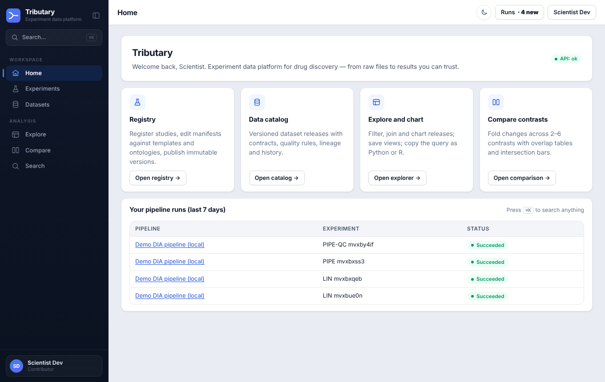

## Find things
- **Quick search:** press **⌘K** (Ctrl+K on Windows and Linux) anywhere. Type an experiment name, cell line,
  compound, protein or gene, and press Enter to open the hit.
- **Search page:** **Search** lists every hit, with facets (type, program, assay, organism). The facets you choose
  are kept in the address, so you can share the link.

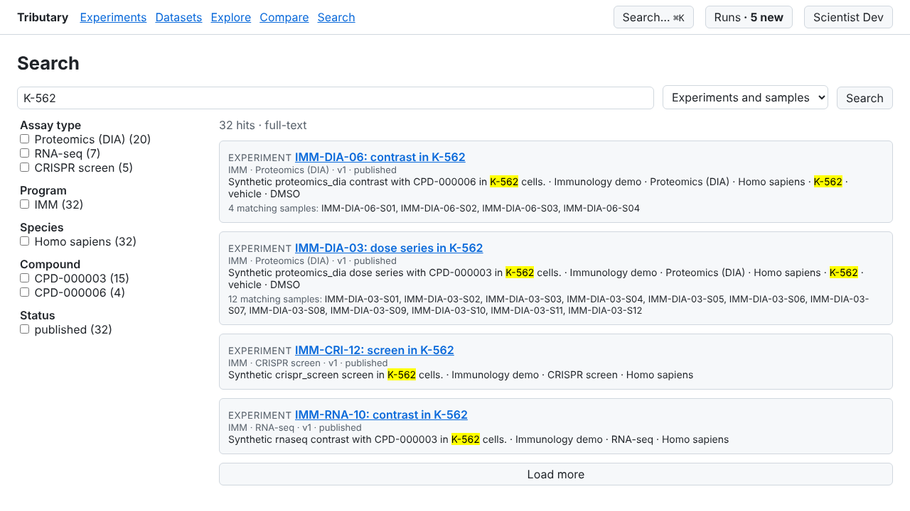

## Register an experiment
1. **Start:** in **Experiments**, choose **New experiment**.
2. **Details:** pick the program and assay type, give the experiment a name and description, and fill in the
   custom fields your program's template asks for. Required fields are marked; **Next** waits until they are valid.
3. **Create:** the new experiment opens as **version 1, draft**.

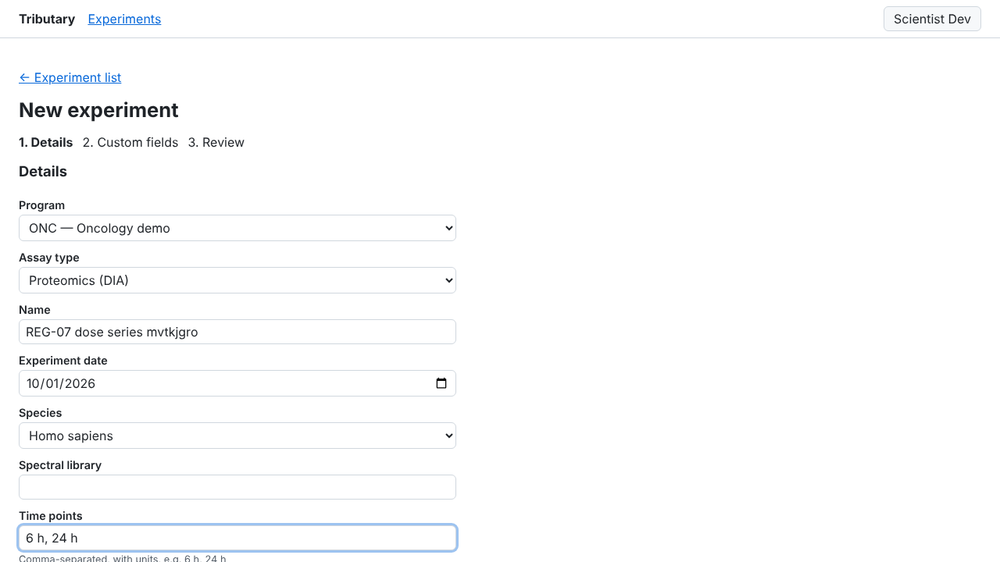

The experiment page has these tabs:
- **Samples**
- **Contrasts**
- **Files**
- **Runs**
- **Versions**
- **Results** (once data exists)

## Samples (the manifest)
The **Samples** tab is a spreadsheet of one row per sample.
- **Typing:** type into cells. Dose and time take a number and a unit (`10 µM`, `24 h`). Tributary stores them in
  SI units and shows them as you typed them.
- **Pasting:** **Paste TSV block** maps the columns of a block copied from Excel or a plate reader file to manifest
  columns. Save the mapping as a preset for the next time.
- **Errors:** every error shows on its cell (an unknown species, a dose without a unit, a duplicate sample key, a
  bad well). **Only rows with problems** filters to them.
- **Plate layout:** colours wells by any factor. Click a well to select its sample.
- **Contrasts:** say which groups to compare. A contrast reads "numerator vs denominator", and log2 fold change
  = log2(numerator / denominator).
- **SDRF:** export and import the manifest in the proteomics SDRF format (validated on the way in and out).
- **Ontology suggestions:** when your admin has switched them on, suggested terms appear for organism, cell line,
  tissue and disease. Only the ones you accept are applied.

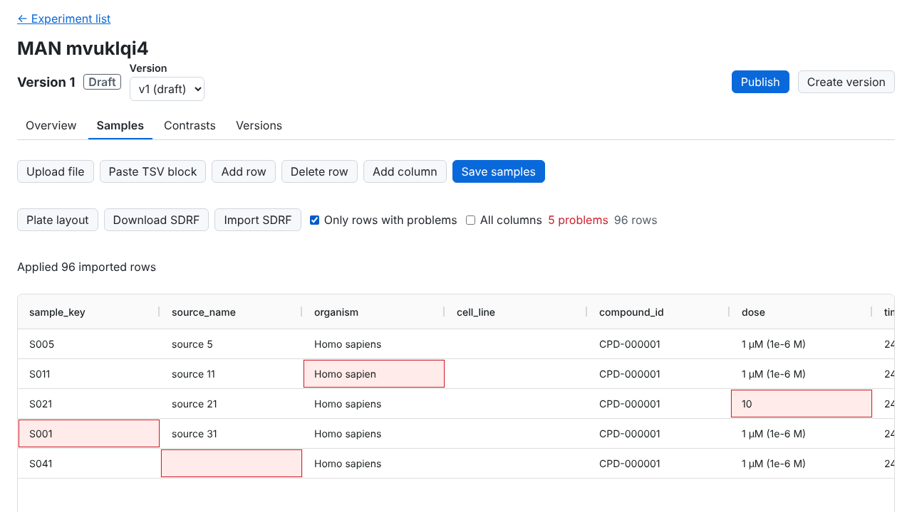
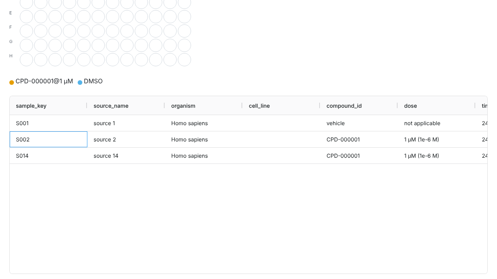

### Excel sample sheets
- **Upload:** **Upload file** accepts `.xlsx` as well as CSV and TSV. Tributary reads the sheet named "samples", or
  else the first sheet, and says which one it read.
- **Check before applying:** the preview lists anything to check first:
  - **Dates:** cells Excel stored as dates are converted to ISO dates and flagged. Excel turns names such as SEPT1
    into dates.
  - **Columns:** duplicate column names and columns without a header are reported.
  - **Numbers** are kept exactly as Excel stored them.
- **Download Excel** saves the manifest as `.xlsx`, with every cell as text so Excel cannot change IDs or gene
  names when you reopen it.

## Publish a version
- **Publishing:** **Publish version** freezes the version: its details, samples and contrasts can never change.
  Every publish asks for a **Reason**. If you signed in a while ago, you are asked to confirm your identity first.
- **Changing it later:** **Versions → New version** copies the published version into a new draft. The
  **Versions** tab shows exactly what changed between any two versions.

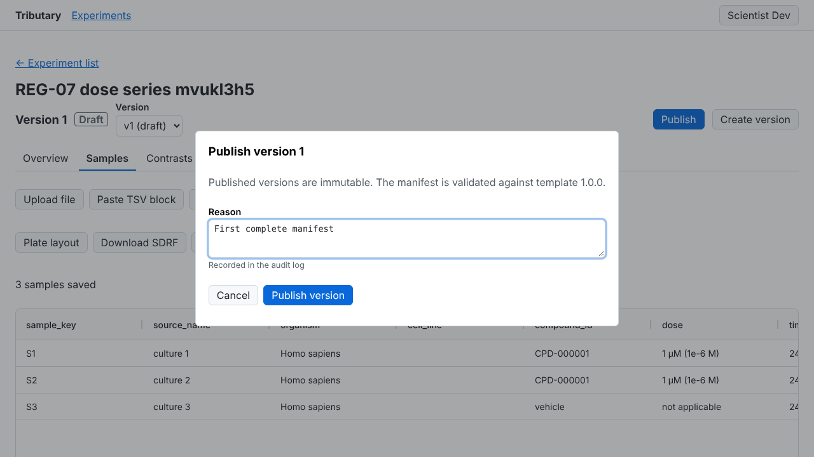
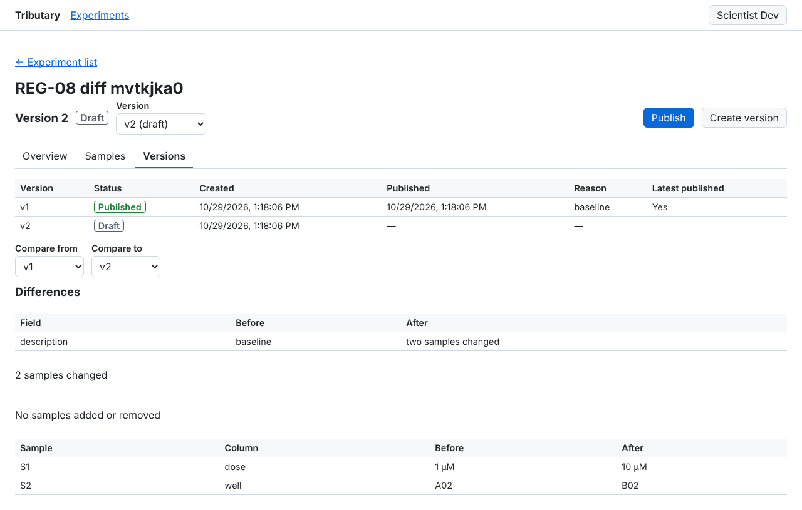

## Upload files
1. **Choose files:** in **Files**, use **Choose files** and give each one a role (raw, processed, …). Then choose
   **Upload**. Large files go straight to storage in parts; an interrupted upload can resume.
2. **QC:** each file is checked when it arrives: checksum, format, and compression integrity. Its status changes from
   uploading → QC passed, or **QC failed** with the reason.
3. **Override:** an approver can **Override QC** with a reason; the override is recorded.

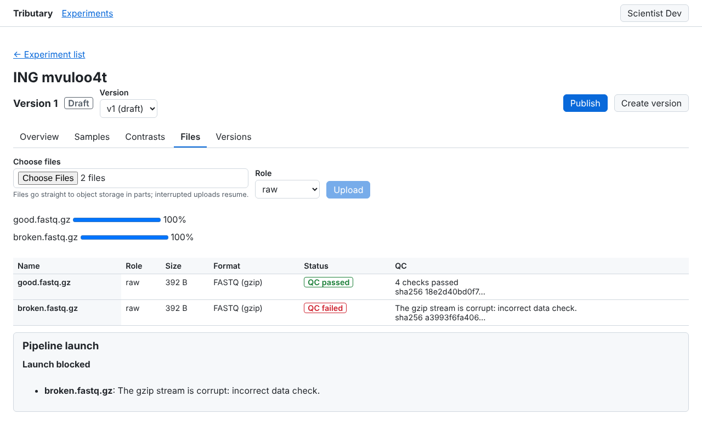

## Run a pipeline
1. **Launch:** from the experiment, choose **Launch pipeline**, pick the pipeline and its revision, and fill in the
   parameter form. The form comes from the pipeline's own schema, so invalid values are caught before launch.
2. **The QC gate:** launch stays disabled, with the reason shown, while an input file has failed QC.
3. **Watch the run:** the run page updates by itself. It shows status, a timeline, recent log lines and outputs.
   You can **Cancel run**, or re-run with edited parameters.
4. **Notifications:** finished runs appear under **Runs** in the top bar.

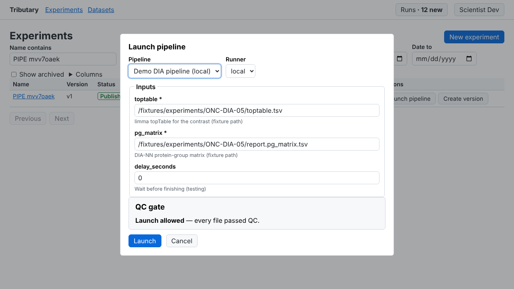
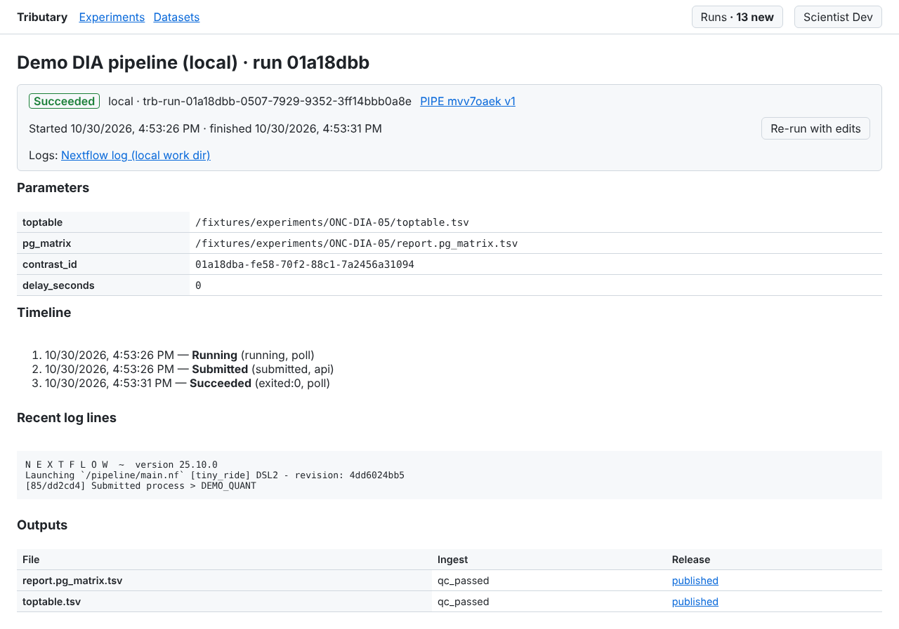

## Import results into a dataset
Results become **datasets** with numbered, immutable **releases**.
1. **Import:** in **Files**, on a processed file, choose **Import…** and pick the importer for the tool that made
   it. Importers cover DIA-NN, MaxQuant, FragPipe, Spectronaut, limma-style tables, CurveCurator and more.
2. **Check:** the new release is **staged**. Check the column statistics, the quality rules and the first rows.
3. **Publish:** **Publish release** with a reason. Only published releases count as the latest data.

Nothing is imputed, filtered or normalised silently. Every transformation is listed on the release.

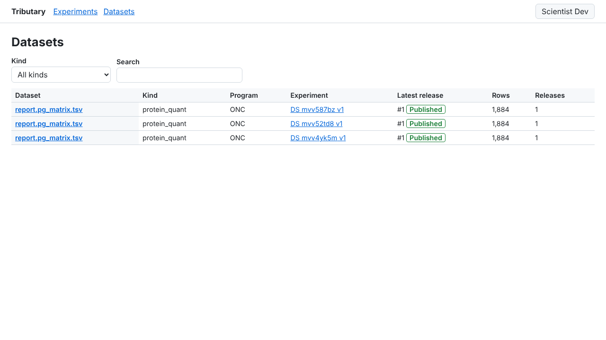

## Explore data
**Explore** queries any dataset kind, across experiments, without writing SQL.
1. **Choose data:** pick a **Dataset kind** and a **Release**, or all releases in your programs. Tick **Latest
   published versions only** for current data.
2. **Filter:** add **+ Rule** and **+ Group** in **Filters**. For example, `adj_p_value < 0.05` AND
   `gene_names contains EGFR`.
3. **Join:** **Add join** brings in sample metadata or reference tables (annotations, compounds).
4. **Run:** **Run query**, then sort by clicking a column, page with **Previous page** and **Next page**, and pick
   columns with **Columns**.
5. **Use the result:**
   - **Export:** CSV, TSV or Parquet (recorded in the audit log).
   - **Save view:** saves the query for yourself or your program. The address always holds the query, so you can
     share it.
   - **Copy as code:** Python, R, or the QuerySpec JSON.

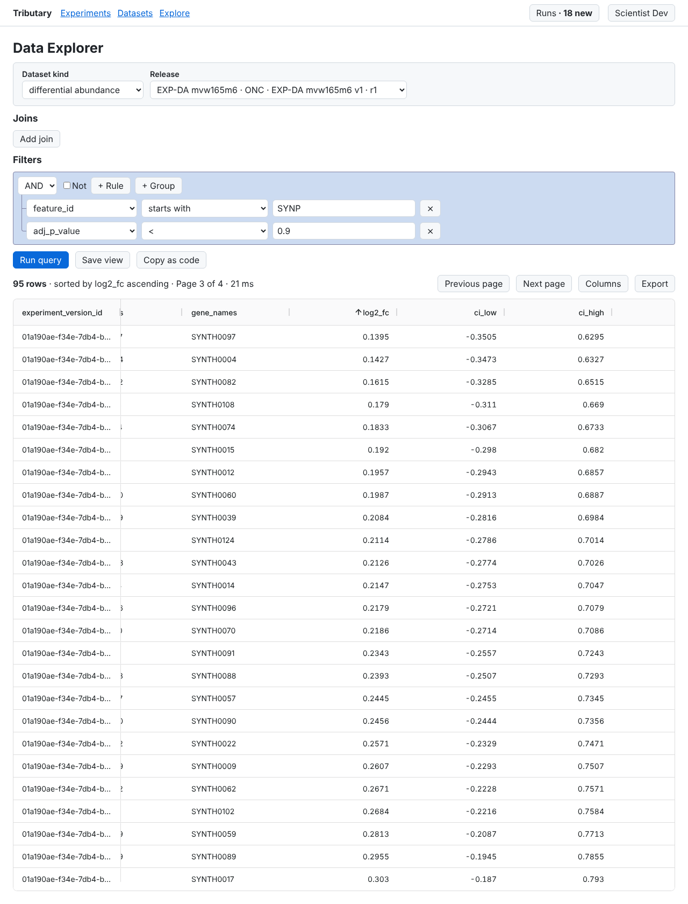
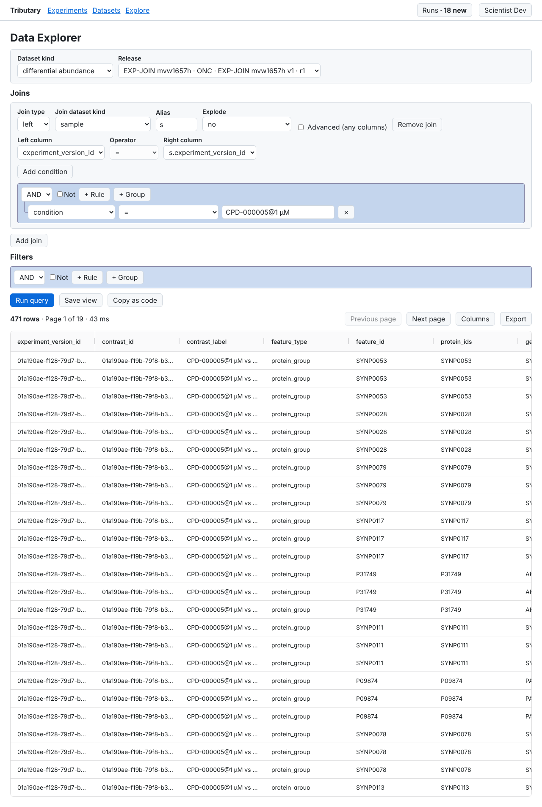

## Charts
Below the results, the **Chart** panel plots the current query.
1. **Chart type:** volcano, MA, heatmap (with clustering and dendrograms), PCA, dose-response, QC panel, line, bar,
   scatter 2D/3D, box/violin, histogram/KDE, lollipop, bubble or pie/donut.
2. **Map columns** to X, Y, colour, label and so on. Only suitable columns are offered.
3. **Options:** thresholds, labels, clustering method, palette (including a colour-blind palette). Errors appear
   next to the option, and **Apply** waits until the chart is valid.
4. **Look closer:**
   - Hover for values.
   - In a volcano, lasso points to list them under **Selected points**.
   - Every chart has a **Chart data** table.
   - **Provenance** says which releases, which query, which transformations and which compute versions made it.
   - Export the chart as PNG or SVG.

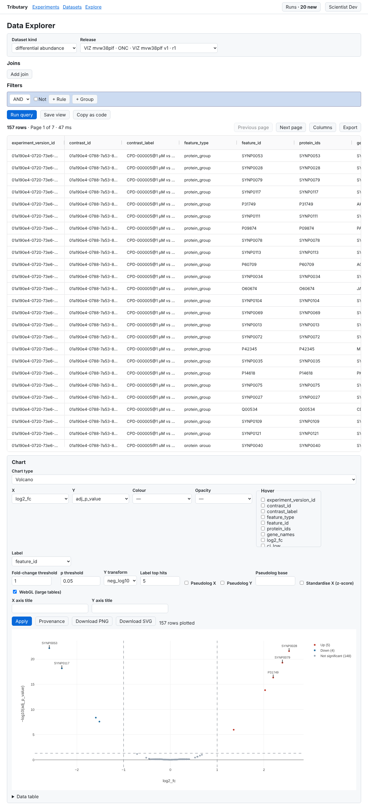
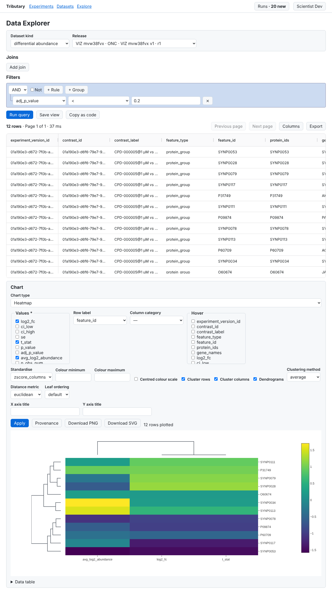

## Results pages
- **Experiment → Results:** QC, a volcano per contrast, top hits, the dose-response viewer (fitted curves as small
  multiples, filtered by regulation and FDR), the files, and a methods paragraph you can paste into a report.
- **Protein pages** (`/proteins/<accession>`): annotations and every experiment and contrast the protein was
  measured in.
- **Compound pages** (`/compounds/<id>`): contrasts, ADME rows, targets, and a known-target overlay on its volcano.
- **Compare:** two contrasts side by side, with a log2 fold-change scatter, an overlap table and intersection bars.

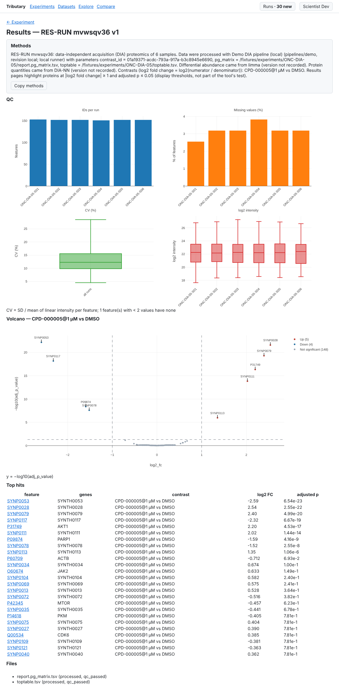
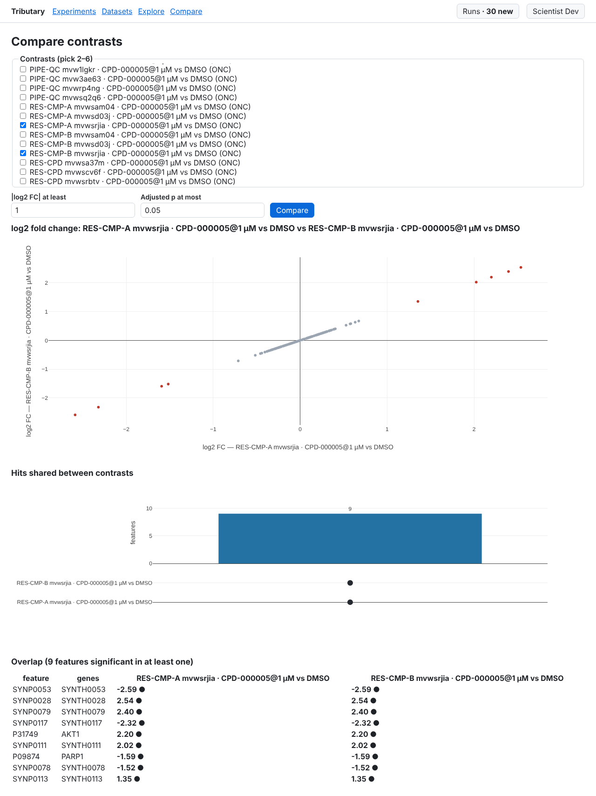

## Pathway enrichment
On an experiment's **Results** page, **Pathway enrichment** asks which gene sets (GO, Reactome or your team's own) are
over-represented among a contrast's hits.
1. **Choose:**
   - the **gene sets**;
   - the **direction** (up, down or both);
   - the **hit thresholds** (adjusted p from the source tool, |log2 FC|);
   - the **set sizes**;
   - the **universe:** every tested identifier, or only those that are in a gene set.
2. **Run enrichment.**
3. **Read the results:**
   - **The dot plot:** −log10 of the gene set's adjusted p. The dashed line is a term FDR of 0.05. Dot size is the
     number of hits in the set, and colour is the fold enrichment.
   - **The table:** hits in each set, fold enrichment, p and adjusted p.
   - **What was counted, and how:** untested features left out, protein groups with several genes, species.

The test is one-sided hypergeometric over-representation with Benjamini–Hochberg adjustment across the sets tested.

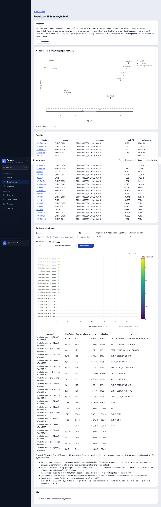

### Reports for meetings
From a results page, open **Report (PDF or PowerPoint)**. It has three parts:
- methods;
- for each contrast, how many proteins pass the display thresholds (up and down), the volcano and the top 10 hits;
- the data and files used.

**Print / save as PDF** prints the page without the app's menus. **Download PowerPoint** builds slides: a title,
methods, then each contrast and its top hits. Both are recorded in the audit log.

### Gene–concept network
After an enrichment run, the **gene–concept network** links the top 8 gene sets (dark squares) to their hit genes
(circles).
- **Gene colour:** a gene's colour is its log2 fold change: blue is down and red is up, at full colour from ±3.
- **Grey genes:** a grey gene with a dashed edge is a hit in more than one feature, for example several protein
  groups. The table gives its count and whether the signs agree. No single value is shown for it.
- **Shared genes:** genes linked to several sets are the ones those pathways share.
- **Table:** the table under the network lists the same links.

## Triage board
**Triage** in the sidebar is each program's list of proteins and compounds it is deciding on.
1. **Add an item:** on a protein or compound page, choose the program in **Triage** and click **Add to triage**. If
   it is already on that program's board, you get the existing item.
2. **Decide:** on the board, click a card. Pick a **Decision** (new, advance, watch, drop), give a **Reason** and click
   **Save decision**. A decision without a reason is not accepted.
3. **Collaborate:**
   - **Assign to me** makes you the owner.
   - Comments are kept in order.
   - **Evidence** shows the release rows attached to the item (log2 FC and adjusted p for proteins).
4. **History:** every change is in the item's history and in the audit log. The board filters by program and kind.

Columns are lists of buttons, so the whole board works with the keyboard and screen readers. There is no drag and
drop.

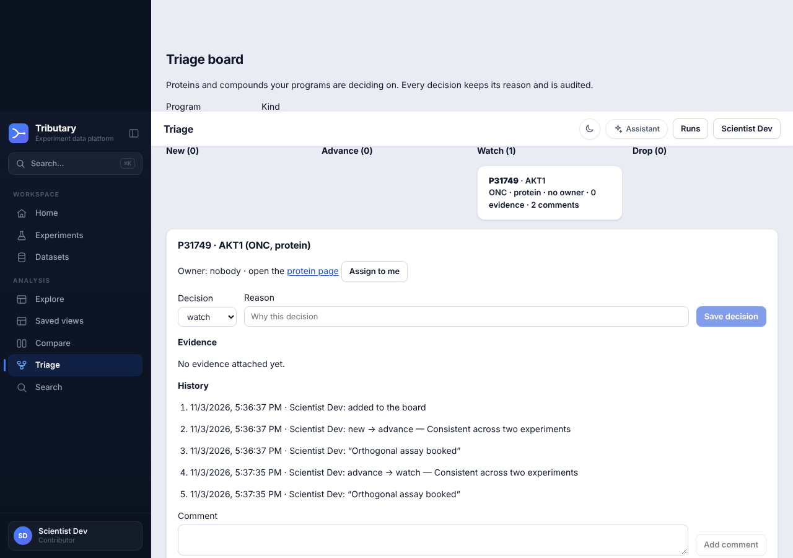

## Watchlists and alerts
- **Watch:** on a protein or compound page, click **Watch**. Click **Watching ✓ — stop** to stop.
- **Alerts:** when a release is published that you can read and that has a hit for something you watch, the
  **Alerts** menu in the top bar shows it. This covers releases from pipelines too.
  - A hit is adjusted p ≤ 0.05 and |log2 FC| ≥ 1; for compounds, presence in a dose-response release.
  - Each alert gives the experiment, contrast, log2 FC and adjusted p, and links to the results.
- **Mark read:** open an alert, or use **Mark all read**.
- **Privacy:** watches and alerts are yours alone. You only hear about programs you can read.

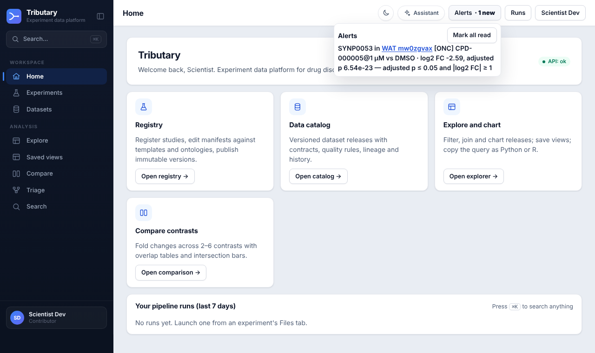

## Cross-experiment QC
**QC** in the sidebar shows the latest published protein quantities of up to 20 experiments you can read.
- **Identifications per run:** experiments are shown oldest first. A run is one sample × instrument run.
  - An ID is a protein group with an intensity above 0 (or a log2 intensity) that the source tool did not mark as
    imputed.
  - There is no q-value filter: IDs are as the tool reported them.
- **Flagged runs:** a run whose IDs fall below half its experiment's median is marked with a red cross. It is
  left out of the PCA.
- **PCA of runs:** the PCA uses the protein groups quantified in every unflagged run (log2, centred, not scaled).
  Colour it by experiment, plate, condition or date. If runs group by plate or date rather than condition, look
  for a batch effect.
  - If experiments report different normalisations, the page says so: the components may then separate tools,
    not batches.
- **Table and list:** the table lists every run. The list below it says exactly what was counted and what was
  left out.

## 3D protein models
A protein page has a **3D model** section.
- **Where the model comes from:** the section says whether a model exists and where it comes from: your
  organisation's model directory, or AlphaFold DB.
- **Viewing it:** press **Show 3D model** to open it in Mol*. Rotate with the mouse, zoom with the wheel, and use
  the expand button for full screen.
- **Colours:** the model is coloured by **pLDDT**, the model's own per-residue confidence: very high (> 90),
  confident (70–90), low (50–70) and very low (≤ 50).
- **Predicted models:** these are predictions, not experimental structures. Read low-confidence regions with care.
- **AlphaFold DB data** is CC BY 4.0: cite it when you reuse a picture.

## Compound structures
- **Compound pages:** a compound page shows its structure, canonical SMILES, a computed InChIKey and descriptors.
  - **Descriptors:** average and exact MW, Crippen logP, TPSA (N and O), Lipinski donors and acceptors (NH+OH,
    N+O), RDKit's donor and acceptor counts, rotatable bonds and rings.
  - **Salts:** a salt or mixture is flagged, and its descriptors cover the whole registered structure.
  - **Batches:** if batches register different structures, the page says so. You can switch batch.
- **Structures page:** search by substructure or by similarity.
  - **Substructure:** type a SMARTS (atoms as written: `C` is aliphatic, `c` aromatic), or choose SMILES to read
    the query as a molecule (Kekulé rings are aromatised). The first match is highlighted.
  - **Similarity:** type a SMILES and a Tanimoto threshold. The fingerprint is Morgan (radius 2, 2048 bits).
  - **Stereochemistry:** both searches ignore it, so enantiomers match and score 1.
  - **Unreadable structures:** registered SMILES that RDKit cannot read are listed under the results so the registry
    can be corrected.

## Lineage and audit
- **Lineage:** shows where a release or chart came from: raw file → pipeline run (with its revision) → release →
  saved chart.
- **Release history:** shows each publish, with its reason and approver.

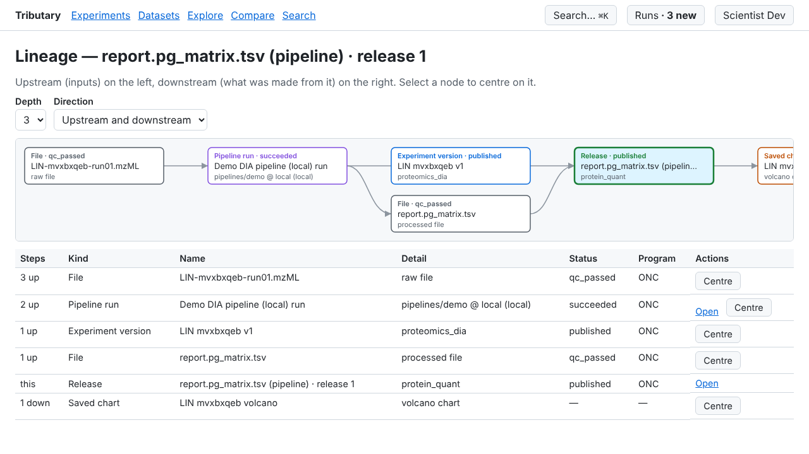

## The assistant
The **Assistant** button opens a side panel, when your organisation has switched it on. Ask in plain language,
for example "Find experiments with HEK293" or "Show the significant hits of contrast X".
- **Visible tool calls:** the assistant answers through the same tools and permissions as you, and shows each
  call it made.
- **Open in Explorer:** a data question becomes a validated query you can open there.
- **Changes need approval:** the assistant never changes data by itself. A proposed change waits for you to
  **Approve**, then runs as you and is audited.

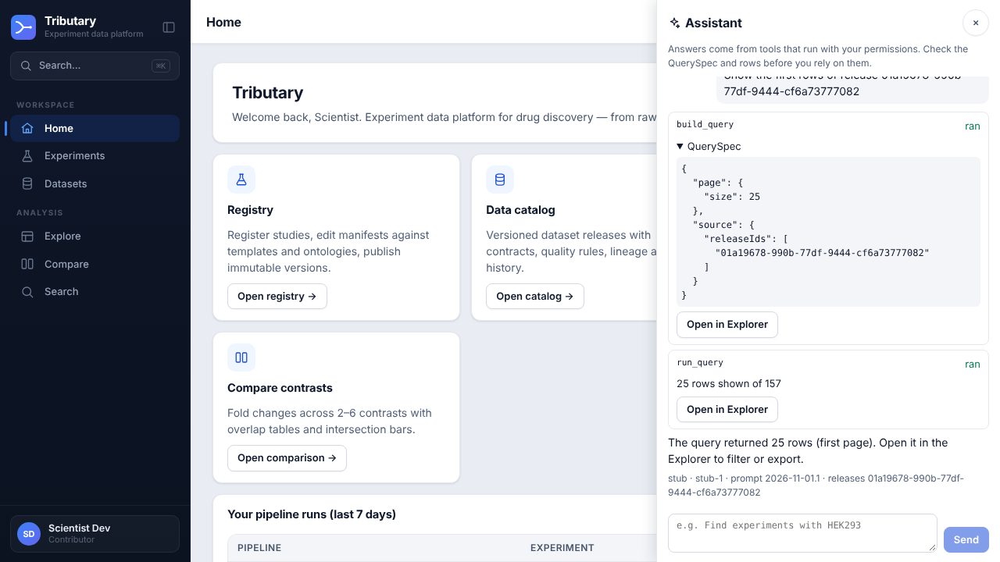

## Python, R and other tools
- **Personal access tokens:** while signed in, create one with `POST /api/v1/auth/tokens` (name, scopes `read` or
  `read` + `write`, and an expiry). Each token is shown once; send it as `Authorization: Bearer trb_…`. There is no
  token page in the web app yet. Locally, `pnpm dev:token` prints one.
- **Python SDK and MCP:** the Python SDK and the MCP endpoint (for AI tools such as Claude Desktop) use the same
  API and permissions. See the README.
- **Copy as code:** in Explore, gives a ready-made snippet.

## Roles
Roles are given per program:

| Role | Can |
|---|---|
| Viewer | Read experiments, datasets, charts and results |
| Contributor | Also create and edit drafts, upload files, launch pipelines, import, save views |
| Approver | Also publish versions and releases, and override QC |
| Admin | Also manage the program's members and settings |
| System admin | Everything, across all programs: templates, pipelines, lists, access, health, audit |

## Glossary
| Term | Meaning |
|---|---|
| Version | A snapshot of an experiment's design and samples; published versions never change |
| Contrast | A comparison "numerator vs denominator" |
| Dataset / release | Tabular results of one kind; each release is immutable and numbered |
| Staged | A release waiting for review before publishing |
| QuerySpec | The structured query the Explorer builds (no SQL) |
| Provenance | What a chart or release was made from, and how |
